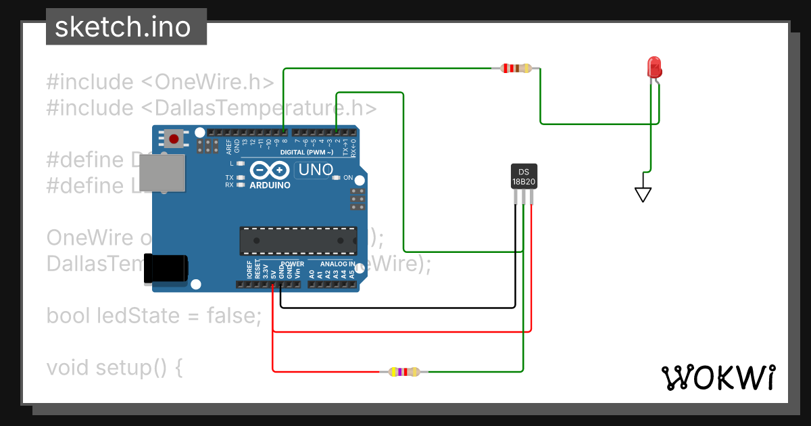

# P1.8 - Giao tiếp 1-Wire với DS18B20 trên Arduino Uno R3

Phần này triển khai nội dung P1.8 trong video bằng **Arduino Uno R3**. Cảm biến DS18B20 gửi nhiệt độ qua bus 1-Wire; chương trình hiển thị kết quả trên Serial Monitor và điều khiển LED theo hai ngưỡng có vùng trễ.

- Video P1.8: <https://www.youtube.com/watch?v=bobMZ3cCz68>
- Mô phỏng Wokwi đã thực hiện: <https://wokwi.com/projects/473944211305579521>
- Sinh viên: **Lê Tư Thiện An**

## 1. Chức năng

- Đọc một cảm biến DS18B20 ở độ phân giải 12 bit.
- Gửi kết quả lên Serial Monitor với tốc độ 9600 baud.
- Bật LED khi nhiệt độ từ `30.0 °C` trở lên.
- Tắt LED khi nhiệt độ từ `28.0 °C` trở xuống.
- Giữ nguyên trạng thái LED trong khoảng `(28.0; 30.0) °C` để tránh nhấp nháy quanh ngưỡng.
- Báo `Sensor error` khi thư viện không tìm thấy cảm biến.

## 2. Linh kiện và nối dây

| Linh kiện | Chân | Nối với Uno R3 |
|---|---|---|
| DS18B20 | VCC | 5V |
| DS18B20 | GND | GND |
| DS18B20 | DQ | D2 |
| Điện trở kéo lên 4,7 kΩ | Đầu 1 | 5V |
| Điện trở kéo lên 4,7 kΩ | Đầu 2 | DQ / D2 |
| LED đỏ | Anode | D8 qua điện trở 220 Ω |
| LED đỏ | Cathode | GND |

> DS18B20 được cấp nguồn ngoài 5V. Bus 1-Wire bắt buộc có điện trở kéo lên 4,7 kΩ giữa DQ và 5V.



## 3. Cấu trúc thư mục

```text
P1.8_DS18B20_UNO_R3/
├── README.md
├── platformio.ini
├── src/
│   └── main.cpp
├── wokwi/
│   ├── sketch.ino
│   ├── diagram.json
│   └── libraries.txt
├── assets/
│   └── wokwi_simulation.png
├── firmware/
│   ├── firmware.hex
│   └── BUILD_INFO.md
└── report/
    ├── Bao_cao_P1.8_DS18B20_UNO_R3.docx
    └── Bao_cao_P1.8_DS18B20_UNO_R3.pdf
```

`wokwi/` là bản sao đúng của project Wokwi do sinh viên cung cấp. `src/main.cpp` là bản tương đương dành cho VS Code + PlatformIO, có tách hàm và dùng hằng số để dễ bảo trì.

## 4. Chạy trực tiếp trên Wokwi

1. Mở liên kết Wokwi ở đầu README.
2. Nhấn nút **Start the simulation**.
3. Mở Serial Monitor.
4. Bấm vào DS18B20 và thay đổi thanh nhiệt độ.
5. Quan sát LED và chuỗi nhiệt độ trên Serial Monitor.

Kết quả mong đợi:

```text
DS18B20 START
Temperature: 22.00 C | LED: OFF
Temperature: 30.00 C | LED: ON
Temperature: 29.00 C | LED: ON
Temperature: 28.00 C | LED: OFF
```

## 5. Build bằng VS Code + PlatformIO

1. Cài VS Code và extension **PlatformIO IDE**.
2. Chọn **File > Open Folder** và mở thư mục `P1.8_DS18B20_UNO_R3`.
3. Chờ PlatformIO tải platform AVR và hai thư viện.
4. Nhấn **Build** (dấu kiểm) hoặc chạy:

   ```bash
   pio run
   ```

5. Kết nối Uno R3 và nhấn **Upload** hoặc chạy:

   ```bash
   pio run -t upload
   ```

6. Mở Serial Monitor ở 9600 baud:

   ```bash
   pio device monitor
   ```

Firmware sau khi build nằm tại `.pio/build/uno/firmware.hex`.

Bản firmware đã kiểm tra trong gói nộp nằm tại `firmware/firmware.hex`.

### Kết quả kiểm tra biên dịch

Mã nguồn đã được biên dịch trực tiếp bằng AVR-GCC 7.3.0 với Arduino AVR Core 1.8.6, OneWire 2.3.8 và DallasTemperature 4.0.6 cho `atmega328p` ở 16 MHz:

- Flash: `8.662 / 32.768 byte` (26,4%).
- SRAM tĩnh: `259 / 2.048 byte` (12,6%).
- SHA-256 của firmware: `3745911a4f3f499ed969bf8469630c5e13153783a4ec9fc8213fd5675be91867`.

## 6. Nguyên lý chương trình

1. `OneWire` tạo bus 1-Wire tại chân D2.
2. `DallasTemperature` thực hiện reset bus, chọn cảm biến, ra lệnh chuyển đổi nhiệt độ và đọc dữ liệu.
3. `requestTemperatures()` bắt đầu phép đo; `getTempCByIndex(0)` lấy nhiệt độ cảm biến đầu tiên.
4. Hai ngưỡng 30°C và 28°C tạo hysteresis:
   - `T >= 30°C`: LED bật.
   - `T <= 28°C`: LED tắt.
   - `28°C < T < 30°C`: giữ trạng thái trước.
5. Mỗi giây, chương trình in nhiệt độ và trạng thái LED.

## 7. Ca kiểm thử

| Ca | Nhiệt độ đặt | LED mong đợi | Ý nghĩa |
|---:|---:|:---:|---|
| 1 | 22°C | OFF | Mức bình thường |
| 2 | 30°C | ON | Chạm ngưỡng bật |
| 3 | 29°C sau ca 2 | ON | Giữ trạng thái trong vùng trễ |
| 4 | 28°C | OFF | Chạm ngưỡng tắt |
| 5 | 29°C sau ca 4 | OFF | Giữ trạng thái trong vùng trễ |
| 6 | Ngắt dây DQ | Báo `Sensor error` | Kiểm tra mất cảm biến; LED giữ trạng thái trước |

## 8. Khác biệt so với mạch trong video

Video trình bày nguyên lý giao tiếp 1-Wire và DS18B20 ở mức vi điều khiển. Bài này giữ nguyên chuỗi xử lý đó nhưng dùng board Uno R3 (ATmega328P, 16 MHz) và thư viện Arduino để thao tác dễ hơn. Mô phỏng Wokwi, mã nguồn PlatformIO và bảng nối dây đều thống nhất ở D2/D8.

## 9. Tài liệu tham khảo

- DS18B20 datasheet: <https://www.analog.com/media/en/technical-documentation/data-sheets/ds18b20.pdf>
- Arduino Uno Rev3: <https://docs.arduino.cc/hardware/uno-rev3>
- Wokwi DS18B20: <https://docs.wokwi.com/parts/wokwi-ds18b20>
- OneWire: <https://github.com/PaulStoffregen/OneWire>
- DallasTemperature: <https://github.com/milesburton/Arduino-Temperature-Control-Library>
