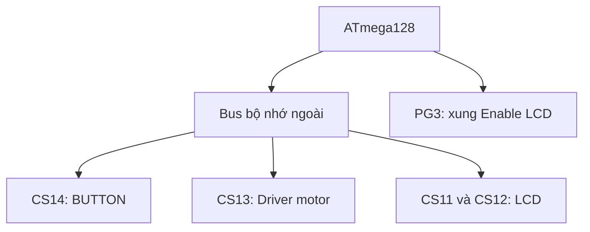

# BÁO CÁO THỰC HÀNH MOTOR – BUTTON – LCD TRÊN ATmega128

## 1. Thông tin chung

- **Vi điều khiển:** ATmega128
- **Ngôn ngữ:** C, biên dịch bằng MPLAB XC8 for AVR
- **Tần số CPU khai báo:** 1 MHz
- **Video tham khảo:** https://youtu.be/rE9QHrk5K4Q
- **Các file được phân tích:** `main.c` và `userdef.h`

> **Lưu ý về phạm vi:** Báo cáo này phân tích trực tiếp chương trình được cung cấp. Nội dung hình ảnh và lời giảng trong video chưa được truy xuất trực tiếp, vì vậy tài liệu không tự suy đoán sơ đồ chân hoặc kết quả thí nghiệm chưa được quan sát.

---

## 2. Mục tiêu bài thực hành

Chương trình được xây dựng nhằm thực hiện các chức năng chính sau:

1. Khởi tạo giao tiếp bộ nhớ ngoài của ATmega128.
2. Đọc trạng thái các nút nhấn từ module BUTTON.
3. Điều khiển chiều quay của motor DC1 bằng nút LEFT và RIGHT.
4. Khởi tạo LCD ký tự và hiển thị chuỗi tại vị trí chỉ định.
5. Làm quen với phương pháp ánh xạ thiết bị ngoại vi vào không gian địa chỉ của vi điều khiển.

Ngoài ba chức năng chính motor, button và LCD, chương trình còn chứa các hàm điều khiển LED và LED 7 đoạn. Đây là phần hỗ trợ của board thực hành, không phải trọng tâm của báo cáo này.

---

## 3. Sơ đồ khối chức năng



| Khối | Nhiệm vụ trong chương trình |
| --- | --- |
| ATmega128 | Thực thi chương trình, đọc nút và gửi lệnh đến ngoại vi |
| Mạch bus/giải mã địa chỉ | Chọn đúng ngoại vi dựa trên địa chỉ truy cập |
| BUTTON | Cung cấp trạng thái tám nút dưới dạng một byte |
| Driver motor | Nhận byte lệnh điều khiển DC1 và DC2 |
| LCD | Nhận lệnh khởi tạo, địa chỉ con trỏ và dữ liệu ký tự |

Tên `CS0` đến `CS19` trong `userdef.h` là các **độ lệch địa chỉ**, không phải tên chân trực tiếp của ATmega128. Muốn lập bảng nối chân chính xác vẫn cần sơ đồ mạch Proteus hoặc sơ đồ board thực hành.

---

## 4. Khởi tạo ATmega128 và bus bộ nhớ ngoài

### 4.1. Khai báo tần số

```c
#define F_CPU 1000000
#include <util/delay.h>
```

`F_CPU` cho thư viện delay biết tần số CPU dùng để tính số chu kỳ chờ. Giá trị `1000000` tương ứng với 1 MHz. 

### 4.2. Bật External Memory Interface

```c
MCUCR |= 0x80;
```

`0x80 = 10000000₂`, vì vậy câu lệnh trên đặt bit 7 của `MCUCR` lên 1. Trên ATmega128, bit 7 là `SRE` – bit cho phép giao tiếp bộ nhớ ngoài XMEM.

Khi XMEM được bật, vi điều khiển sử dụng các đường bus địa chỉ, bus dữ liệu và các tín hiệu điều khiển như ALE, RD, WR để truy cập thiết bị ngoại vi. 

### 4.3. Cấu hình Port G

```c
DDRG = 0x0F;
```

`0x0F = 00001111₂`, đặt PG0–PG3 ở chế độ output. Khi XMEM hoạt động, PG0–PG2 được dùng cho các chức năng WR, RD và ALE. Chương trình dùng PG3 để tạo xung Enable cho LCD:

```c
#define LCDE_H (PORTG |=  (1 << 3))
#define LCDE_L (PORTG &= ~(1 << 3))
```

---

## 5. Bảng ánh xạ địa chỉ ngoại vi

Địa chỉ cơ sở được khai báo:

```c
#define EXMEM_ADD 0x1100
```

Địa chỉ của mỗi thiết bị được tính bằng:

```text
Địa chỉ thiết bị = EXMEM_ADD + CSn
```

| Độ lệch | Địa chỉ | Thiết bị/chức năng |
| ---: | ---: | --- |
| CS0–CS3 | `0x1100`–`0x1103` | LED0–LED3 |
| CS4–CS7 | `0x1104`–`0x1107` | Bốn LED 7 đoạn trực tiếp |
| CS8 | `0x1108` | Chọn LED 7 đoạn quét |
| CS9 | `0x1109` | Dữ liệu LED 7 đoạn quét |
| CS10 | `0x110A` | Relay |
| CS11 | `0x110B` | Dữ liệu LCD |
| CS12 | `0x110C` | Lệnh LCD |
| CS13 | `0x110D` | Điều khiển motor DC |
| CS14 | `0x110E` | Đọc button |
| CS15–CS19 | `0x110F`–`0x1113` | Đã khai báo nhưng chưa dùng trong code |

Ví dụ:

```c
#define LCD_DATA *(unsigned char *)(EXMEM_ADD + CS11)
#define LCD_INS  *(unsigned char *)(EXMEM_ADD + CS12)
#define MOTORDC  *(unsigned char *)(EXMEM_ADD + CS13)
#define BUTTON   *(unsigned char *)(EXMEM_ADD + CS14)
```

---

## 6. Phân tích phần MOTOR

### 6.1. Các trạng thái motor

```c
#define STOP    0
#define FORWARD 1
#define REWARD  2
```

| Tên trạng thái | Giá trị hai bit | Ý nghĩa theo tên trong code |
| --- | ---: | --- |
| `STOP` | `00` | Dừng motor |
| `FORWARD` | `01` | Quay theo chiều thuận |
| `REWARD` | `10` | Quay theo chiều còn lại |
| Chưa định nghĩa | `11` | Không được sử dụng |


### 6.2. Cấu trúc lưu trạng thái motor

```c
struct Motor {
    unsigned char DC1    : 2;
    unsigned char DC2    : 2;
    unsigned char DCFree : 4;
};

struct Motor Motors;
```

Một byte được chia thành:

| Bit | Trường | Chức năng |
| --- | --- | --- |
| 1..0 | `DC1` | Trạng thái motor DC1 |
| 3..2 | `DC2` | Trạng thái motor DC2 |
| 7..4 | `DCFree` | Chưa sử dụng |

### 6.3. Khởi tạo motor

```c
Motors.DC1 = STOP;
Motors.DC2 = STOP;
MOTOR_ACTIVATION;
```

Hai phép gán đầu tiên chỉ thay đổi biến `Motors` trong RAM. Macro `MOTOR_ACTIVATION` mới ghi byte lệnh tới địa chỉ motor:

```c
#define MOTOR_ACTIVATION \
    (*(volatile unsigned char *)(EXMEM_ADD + CS13) = \
     *(unsigned char *)(&Motors))
```

Trình tự hoạt động:

1. Gán trạng thái mong muốn cho `Motors.DC1` hoặc `Motors.DC2`.
2. Gọi `MOTOR_ACTIVATION`.
3. Byte trong cấu trúc `Motors` được xuất đến địa chỉ `0x110D`.
4. Mạch driver nhận tín hiệu và điều khiển motor.

Nếu chỉ gán `Motors.DC1 = FORWARD` mà không gọi `MOTOR_ACTIVATION`, driver chưa nhận được lệnh mới.

### 6.4. Chức năng motor trong chương trình

Ý định của đoạn code là:

- Nhấn LEFT: đặt DC1 thành `REWARD`.
- Nhấn RIGHT: đặt DC1 thành `FORWARD`.
- DC2 luôn giữ trạng thái `STOP`.

Chương trình không có PWM hoặc bộ định thời điều khiển tốc độ. Do đó, chức năng hiện tại chỉ là dừng và chọn chiều motor, chưa có điều chỉnh tốc độ hay đo RPM.

Chiều quay cơ học thật còn phụ thuộc vào driver và cách nối hai đầu motor. Tên `FORWARD` không tự đảm bảo motor quay theo một chiều cố định nếu đảo dây motor.

---

## 7. Phân tích phần BUTTON

### 7.1. Cấu trúc button

```c
struct Button {
    unsigned char LEFT  : 1;
    unsigned char RIGHT : 1;
    unsigned char UP    : 1;
    unsigned char DOWN  : 1;
    unsigned char GO    : 1;
    unsigned char BTN1  : 1;
    unsigned char BTN2  : 1;
    unsigned char BTN3  : 1;
};

struct Button Buttons;
```

Mỗi nút sử dụng một bit. Toàn bộ tám nút vừa đủ một byte.

### 7.2. Đọc trạng thái nút

```c
#define ReadKey \
    (*(unsigned char *)(&Buttons) = \
     *(unsigned char *)(EXMEM_ADD + CS14))
```

Khi thực hiện:

```c
ReadKey;
```

ATmega128 đọc một byte từ địa chỉ `0x110E`, sau đó lưu byte đó vào cấu trúc `Buttons`. Chương trình có thể kiểm tra từng bit thông qua `Buttons.LEFT`, `Buttons.RIGHT`, ...

### 7.3. Mức tác động của nút

Code sử dụng:

```c
if (!Buttons.LEFT)
```

Dấu `!` đảo trạng thái logic. Vì vậy chương trình đang giả định nút **active-low**:

| LEFT | RIGHT | Trạng thái dự kiến |
| ---: | ---: | --- |
| 1 | 1 | Không nhấn nút |
| 0 | 1 | Nhấn LEFT |
| 1 | 0 | Nhấn RIGHT |
| 0 | 0 | Hai nút cùng được nhấn |

Cực tính này phải được kiểm tra lại bằng mạch thực tế hoặc Logic Analyzer trong Proteus.

### 7.4. Chờ thả nút

```c
while (!Buttons.LEFT)
    ReadKey;
```

Khi LEFT còn được giữ, chương trình liên tục đọc lại trạng thái. Chỉ sau khi người dùng thả LEFT, chương trình mới đi đến lệnh điều khiển motor.

Ưu điểm là một lần giữ nút không làm lệnh motor bị ghi lặp quá nhanh. 


## 8. Phân tích phần LCD

### 8.1. Hai vùng ghi của LCD

```c
#define LCD_DATA *(unsigned char *)(EXMEM_ADD + CS11)
#define LCD_INS  *(unsigned char *)(EXMEM_ADD + CS12)
```

| Macro | Địa chỉ | Công dụng |
| --- | ---: | --- |
| `LCD_DATA` | `0x110B` | Ghi mã ký tự cần hiển thị |
| `LCD_INS` | `0x110C` | Ghi lệnh điều khiển LCD |

Sau khi ghi một byte, chương trình tạo xung ở chân E:

```c
LCDE_H;
_delay_us(1);
LCDE_L;
```

Xung E thông báo cho LCD chốt và xử lý byte đang có trên bus.

### 8.2. Hàm khởi tạo LCD

```c
void LCDInit()
{
    LCD_INS = 0x38;
    LCDE_H; _delay_us(1); LCDE_L; _delay_us(200);

    LCD_INS = 0x0C;
    LCDE_H; _delay_us(1); LCDE_L; _delay_us(200);

    LCD_INS = 0x06;
    LCDE_H; _delay_us(1); LCDE_L; _delay_us(200);

    LCD_INS = 0x01;
    LCDE_H; _delay_us(1); LCDE_L; _delay_ms(20);
}
```

| Lệnh | Ý nghĩa |
| --- | --- |
| `0x38` | Giao tiếp 8 bit, hai dòng nội bộ, font 5×8 |
| `0x0C` | Bật màn hình, tắt con trỏ, tắt nhấp nháy |
| `0x06` | Sau khi ghi ký tự, con trỏ tự tăng sang phải |
| `0x01` | Xóa LCD và đưa con trỏ về đầu |

Code đang sử dụng chế độ LCD **8 bit**, không phải giao tiếp 4 bit.

### 8.3. Hàm in chuỗi

```c
void PrintL(const char *str, unsigned char line, unsigned char col)
{
    unsigned char add;

    switch (line) {
        case 0: add = 0x80; break;
        case 1: add = 0xC0; break;
        case 2: add = 0x94; break;
        case 3: add = 0xD4; break;
    }

    LCD_INS = add + col;
    LCDE_H; _delay_us(1); LCDE_L; _delay_us(50);

    while (*str != '\0') {
        LCD_DATA = *str++;
        LCDE_H; _delay_us(1); LCDE_L; _delay_us(10);
    }
}
```

Hàm gồm hai bước:

1. Chọn địa chỉ đầu dòng và cộng với vị trí cột.
2. Gửi lần lượt từng ký tự cho đến khi gặp ký tự kết thúc chuỗi `\0`.

| Giá trị `line` | Địa chỉ | Vị trí theo ánh xạ LCD 20×4 trong code |
| ---: | ---: | --- |
| 0 | `0x80` | Dòng 1 |
| 1 | `0xC0` | Dòng 2 |
| 2 | `0x94` | Dòng 3 |
| 3 | `0xD4` | Dòng 4 |

Lệnh trong `main()`:

```c
PrintL("hello", 3, 0);
```

yêu cầu in `hello` tại **dòng 4, cột đầu tiên** theo bảng trên. Nếu mạch dùng LCD 16×2, nên thử:

```c
PrintL("hello", 0, 0);
```

để hiển thị tại dòng đầu tiên.

Hàm `PrintL()` hiện chưa xử lý các trường hợp `line` ngoài 0–3, `col` vượt chiều rộng LCD hoặc chuỗi dài hơn phần còn lại của dòng.

---

## 9. Luồng hoạt động dự kiến của chương trình

1. Bật giao tiếp bộ nhớ ngoài bằng bit SRE.
2. Cấu hình Port G.
3. Gọi `SegDisplay(3214)` để quét thử LED 7 đoạn.
4. Đặt DC1 và DC2 về `STOP`.
5. Ghi trạng thái ban đầu ra driver motor.
6. Khởi tạo LCD.
7. In chuỗi `hello` tại vị trí được yêu cầu.
8. Vào vòng lặp vô hạn và liên tục đọc button.
9. Khi LEFT được nhấn rồi thả, đặt DC1 thành `REWARD`.
10. Khi RIGHT được nhấn rồi thả, đặt DC1 thành `FORWARD`.
11. Gọi `MOTOR_ACTIVATION` để cập nhật driver.

Các bước 9–11 là ý định có thể suy ra từ tên lệnh. Bản code được dán hiện có lỗi dấu ngoặc nên chưa thực hiện đúng luồng trên.

---

## 10. Bảng kiểm thử trên MPLAB X và Proteus

| Bước | Thao tác | Kết quả dự kiến | Kết quả thực tế |
| ---: | --- | --- | --- |
| 1 | Chọn đúng ATmega128 và build project | Không còn lỗi cú pháp/link |không lỗi|
| 2 | Cài clock đúng 1 MHz | Delay và LCD làm việc đúng thời gian |đã thực hiện|
| 3 | Khởi động mô phỏng | DC1 và DC2 nhận `STOP` |đã thực hiện|
| 4 | Quan sát LCD | `hello` xuất hiện tại vị trí đã chọn | Chưa ghi nhận |
| 5 | Nhấn rồi thả LEFT | DC1 nhận lệnh `REWARD` |đã thực hiện|
| 6 | Nhấn rồi thả RIGHT | DC1 nhận lệnh `FORWARD` |đã thực hiện|
| 7 | Nhấn cả LEFT và RIGHT | LEFT được ưu tiên trong code đã sửa |đã thực hiện|
| 8 | Quan sát tín hiệu CS13 | Byte motor thay đổi đúng theo lệnh |đã thực hiện|
| 9 | Nhấn nút nhiều lần | Không xuất hiện tác động sai do dội nút |đã thực hiện|

## 11. Kết luận

Chương trình minh họa phương pháp điều khiển nhiều thiết bị ngoại vi bằng giao tiếp bộ nhớ ngoài của ATmega128. Button được đọc dưới dạng một byte, trạng thái motor được đóng gói trong cấu trúc bit-field và LCD được điều khiển bằng vùng ghi lệnh, vùng ghi dữ liệu cùng xung Enable từ PG3.

Code thể hiện được ý tưởng chính vẫn còn lỗi hiển thị lcd.

## 14. Tài liệu tham khảo

1. Video do giảng viên cung cấp: https://youtu.be/rE9QHrk5K4Q
2. Microchip, *ATmega128/L Datasheet*: https://ww1.microchip.com/downloads/en/DeviceDoc/doc2467.pdf
3. Hitachi, *HD44780U LCD Controller/Driver Datasheet*: https://cdn.sparkfun.com/assets/9/5/f/7/b/HD44780.pdf
4. Microchip, *AVR Software User Guide – F_CPU*: https://onlinedocs.microchip.com/oxy/GUID-78362176-487F-41B9-95C7-B478A9A186EB-en-US-2/GUID-19D17420-19A7-43D6-9517-1FAD8F0A3143.html
